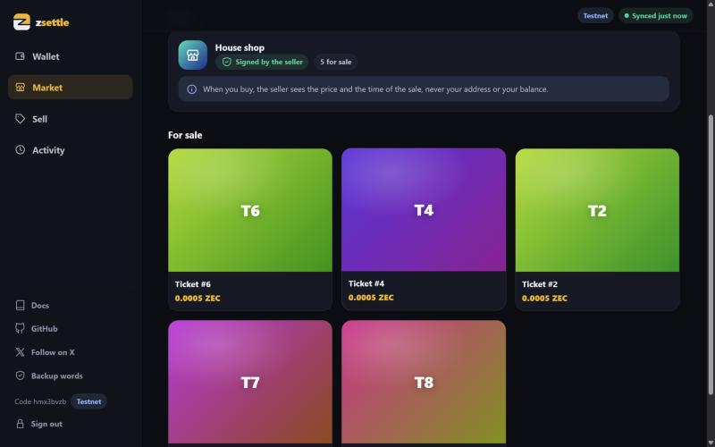
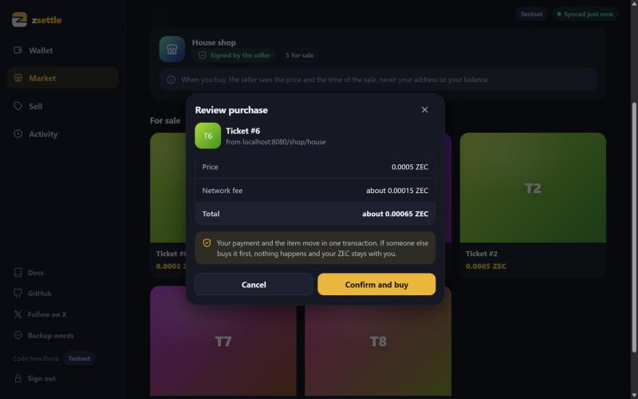
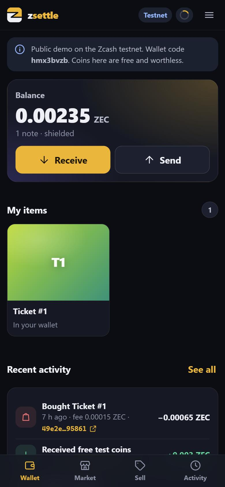

# zsettle

zsettle trades an item for ZEC in one shielded Zcash transaction, between two parties, with no
custodian. The item is a shielded note in the Ironwood pool. The trade is a two-party PCZT:
the buyer builds and proves it, the seller checks it and signs only the item's half, and the
buyer signs the payment's half and broadcasts. Either both halves land on chain, or nothing
moves.

## How one trade works

1. The seller publishes a signed listings file: a viewing key for the item account, a payout
   address, and the items with their prices.
2. The buyer builds one transaction with both halves (item to the buyer, price to the seller)
   and proves it, holding only viewing keys.
3. The seller's service verifies the proof and the payment, and signs the item spend.
4. The buyer signs the payment spend and broadcasts. If the item was spent elsewhere first,
   the whole trade is invalid and the buyer's ZEC never moves.

## The app

`zsettle-app` puts the same tools in a browser, on a phone or a desktop: a wallet unlocked
by a passkey, a market of signed shops, a buy with a review step, and each item's history
read from the chain.

| A shop | Review before buying | An item's history | On a phone |
|---|---|---|---|
|  |  |  |  |

## Links

- Documentation: <https://nerses-asaturyan.github.io/zsettle/book/>
- Project page: <https://nerses-asaturyan.github.io/zsettle/>
- Hosted testnet demo: the link is on the [project page](https://nerses-asaturyan.github.io/zsettle/)
- Releases: <https://github.com/nerses-asaturyan/zsettle/releases>

The book's source is in [`book/`](book/src/SUMMARY.md). The protocol notes are in
[`spec/PROTOCOL.md`](spec/PROTOCOL.md) and [`spec/THREAT_MODEL.md`](spec/THREAT_MODEL.md).

## Build from source

```
git clone https://github.com/nerses-asaturyan/zsettle
cd zsettle
cargo build --release --locked    # Rust 1.93.1, pinned in rust-toolchain.toml
./target/release/zsettle --help
```

This builds `zsettle` (buyer), `zsettle-seller` (seller and its service) and `zsettle-app`
(web page). The `main` branch targets mainnet (NU6.3); the `nu7-testnet` branch targets the
testnet.

This branch targets the Zcash testnet (NU7) with the pre-release crates; see
[docs/TESTNET.md](docs/TESTNET.md).

Try it without a wallet:

```
./target/release/zsettle verify --listings examples/market.json --listings examples/market2.json \
  --item af09c2cf525d2bb6e553b61a1d3cc2674ebdf09726be1e3959ee36f5143f5804:0
```

This is young software and has not been audited. See [SECURITY.md](SECURITY.md) to report
problems.

## Licence

MIT OR Apache-2.0, at your option.
