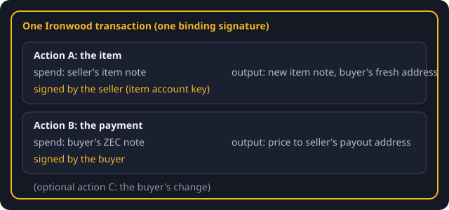

# The trade in one transaction

A trade is one Ironwood transaction with two spends, under two different full viewing keys,
both witnessed at the same anchor:

- **Action A** spends the seller's item note and creates a new item note for the buyer.
- **Action B** spends the buyer's ZEC note and pays the listed price to the seller.
- If the buyer's note is worth more than price plus fee, there is a third output: the
  buyer's change.

The code is `build_trade` in `crates/zsettle-core/src/trade.rs`.

## Who signs what

Each spend needs a spend authorization signature from the key that owns the spent note:

- the seller signs action A with the item account's key;
- the buyer signs action B with the buyer account's key.

Neither side can sign the other side's action, and the seller service signs exactly one
action: the one that spends the listed item.

## Why it is all-or-nothing

- Both spends are in one transaction, held together by one binding signature. A transaction
  with an unsigned action is invalid, so neither half can be used alone.
- The signature hash (ZIP 244) covers every action's value commitment, nullifier, randomized
  key, note commitment and ciphertext. Once the seller has signed, the buyer cannot change the
  payment without making the seller's signature invalid.
- If the seller spends the item note somewhere else first, the trade's item nullifier is
  already on chain. Consensus rejects the whole trade, and the buyer's ZEC never moves.
- If the buyer never broadcasts, the seller's signature stops being useful at the expiry
  height. The default and maximum expiry is the same as other librustzcash wallet
  transactions: 40 blocks before NU7, 120 from NU7, about 50 minutes either way.

## What the transaction looks like

A trade has two or three actions, the ecosystem's default expiry, the conventional ZIP 317 fee
and a normal anchor depth, like an ordinary wallet transaction. (The one exception: the wallet in
the browser, paying with coins less than three blocks old, anchors at the newest block.) To someone without the
listings file it is not marked as a trade. See [Privacy](../privacy.md) for what a listings
holder can tell.

Fees:

- with change: three actions, 15,000 zatoshis;
- with an exact paying note (price + 10,000): two actions, 10,000 zatoshis.

The buyer pays the fee. Change that would be dust (5,000 zatoshis or less) is refused rather
than created.

## The item spend and the item output share an action

The successor item note must be the output of the same action that spends the old item note.
Then its `rho` is the old note's nullifier, and that is what links an item's history. The
Orchard builder pairs spends and outputs at random, so `build_trade` rebuilds the bundle with
fresh randomness until the item spend and the item output are in one action. Proving happens
once, after the pairing holds.
