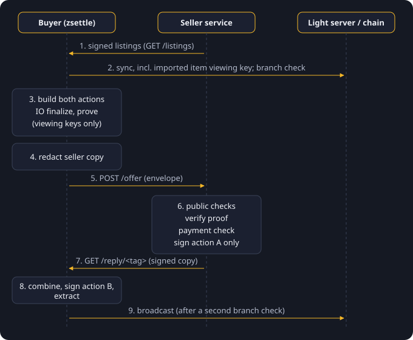

# The two-party PCZT flow

A PCZT (ZIP 374) is a transaction that is passed between parties while it is being built.
Each party plays one or more *roles*. In zsettle the buyer does almost all the work, and the
seller only checks and signs.

## Who does what

| Step | Who | Role | Code |
|---|---|---|---|
| Publish signed listings | seller | | `zsettle-seller publish` |
| Import the item viewing key, sync | buyer | | `zsettle import-listing`, `zsettle sync` |
| Build the bundle (both actions) | buyer | Creator | `trade::build_trade` |
| Finalize inputs and outputs | buyer | IO Finalizer | `trade::build_trade` |
| Make the proof | buyer | Prover | `trade::build_trade` |
| Remove the buyer's secrets from the seller copy | buyer | Redactor | `pczt::redact_for_seller` |
| Check the offer, verify the proof | seller | Verifier | `policy::check_public`, `pczt::verify_proof`, `policy::check` |
| Sign action A | seller | Signer | `pczt::sign_ironwood_action` |
| Merge the signed copy with the full PCZT | buyer | Combiner | `pczt::combine` |
| Sign action B | buyer | Signer | `pczt::sign_matching_actions` |
| Finalize spends, extract the transaction | buyer | Spend Finalizer, Transaction Extractor | `pczt::extract` |
| Broadcast | buyer | | `zsettle finish --broadcast` |

In the Code column, `trade::build_trade` means the function `build_trade` in
`crates/zsettle-core/src/trade.rs`, and so on.

## Step by step

1. **The seller publishes** a signed listings file (see [Listings](listings.md)).
2. **The buyer imports and syncs.** `zsettle import-listing` adds the item account's viewing
   key as a view-only account. `zsettle sync` scans both accounts, so the wallet has the item
   note and a witness for it.
3. **The buyer checks the branch.** `buy` asks the light server which consensus branch is live
   at the next block, and stops if this build does not sign for it.
4. **The buyer builds and proves.** Both notes are witnessed at one anchor. The bundle has
   the item spend and item output in one action, the payment output, and change if needed.
   The expiry is the next block plus the listing's limit, never more than the standard expiry
   (40 blocks before NU7, 120 from NU7). The proof is
   made with the two full viewing keys; no spending key is needed.
5. **The buyer redacts the seller copy.** The seller copy keeps what fixes the sighash, the
   proof, and the item action's own spend data, which the seller's signer needs. Removed: the
   buyer's viewing key, witnesses, note randomness, spend randomizers of the other actions,
   output plaintext data, value-commitment trapdoors and the binding-signature key. The buyer
   records the paying note as reserved until the expiry height.
6. **The buyer sends the offer**, by `POST /offer` or by writing the file into the seller's
   inbox.
7. **The seller checks the offer** (next section) and, if it passes, signs action A only.
8. **The buyer fetches the reply**, by `GET /reply/<tag>` or from the outbox.
9. **The buyer finishes.** The combiner merges the full PCZT and the signed copy; any field
   that differs fails the merge, so the seller cannot alter the trade. The buyer signs action
   B, finalizes the spends and extracts the transaction. Extraction checks the proof and both
   signatures. The buyer checks the server's branch again and broadcasts.

## What the seller checks

The service checks an envelope in three stages. Each stage runs only when the one before it
passed. Code: `sign_envelope` in `crates/zsettle-seller/src/main.rs` and
`crates/zsettle-core/src/policy.rs`.

**Before anything:** the envelope is at most 1 MiB and parses as a PCZT, and has at most three
actions. The service finds which listed item it spends by comparing nullifiers.

**Stage one, public data only** (`check_public`):

- the envelope's consensus branch is the one live at the next block;
- an expiry is set, it is after the chain tip, and it is at most the listing's limit,
  converted to blocks at the tip, plus 1 (one block of slack, because the buyer counts from the
  next block);
- the bundle's anchor is a tree root the seller's own wallet has for one of the last 100
  blocks;
- exactly one action spends the listed item note, and it has a non-zero spend randomizer.

**Stage two, the proof** (`verify_proof`): the proof is checked against the bundle's public
inputs (anchor, value commitments, nullifiers, randomized keys, note commitments). This is
done once per envelope; a deferred envelope is not checked again.

**Stage three, checks with the seller's own keys** (`check`):

- no other action spends another note of the listed item account;
- the outputs that decrypt under the payout account's incoming viewing key, and that go to the
  listed payout address, add up to at least the price. Outputs of 5,000 zatoshis or less do
  not count.

Every decision depends only on data a listings holder can compute: the listed payout address
and the listed account's own notes. So a refusal does not reveal what else the seller's wallet
holds.

The anchor rule matters. A proof only shows that a note is in the tree whose root it was made
for. Without the rule, a proof over a made-up tree would pass.

Some refusals are not final. When the buyer is a few blocks ahead of the seller (an anchor
the seller has not scanned yet, or an expiry measured from a later tip), or a listed note is
not spendable in the seller wallet yet, the envelope is **deferred** and checked again in a
later pass. A deferral is given up after ten blocks.

## Several offers for one item

The seller signs every acceptable offer. Several signed offers for one item can exist at the
same time. They all spend the same item nullifier, so at most one is mined, and the seller is
paid once. A buyer who loses the race loses only the time spent proving. That buyer should
run `zsettle rotate` later (see [Buying](../cli/buyer.md#after-an-offer-that-did-not-settle)).
