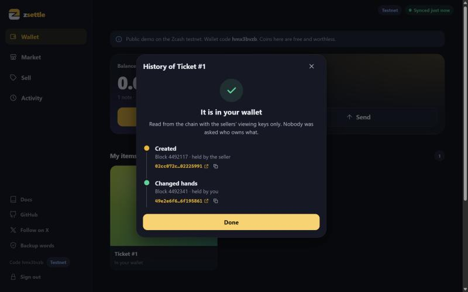

# Run the app on your computer

`zsettle-app` is zsettle in a browser, on a desktop or a phone. It has a wallet unlocked by a
passkey or a passphrase, a market where you open a shop by its address, buying with a review
step and live progress, a seller page to mint items, set prices and open your shop, item
histories from the chain, a QR code to receive, and backup words. Transaction links open the
ZecBlock explorer.




The app adds no cryptography of its own. For every action it runs the `zsettle` and
`zsettle-seller` programs next to it and reads what they print.

## Start it

```
zsettle-app
```

It prints a link like `http://localhost:7070/#token=<32 hex characters>`. Open that link in
your browser. The part after `#token=` is the page key for this profile: keep it to
yourself. The key is saved with the profile, so the link stays the same across restarts.
`--new-token` makes a new key, and old links stop working.

To play buyer and seller on one machine, run a second profile on a second port:

```
zsettle-app --profile bob --port 7071
```

## Options

| Flag | Default | Meaning |
|---|---|---|
| `--profile <name>` | `default` | Profile name. Each profile has its own wallet, shop and history. Letters, digits, `-` and `_`. |
| `--data-dir <dir>` | `~/.zsettle-app` | Directory that holds the profiles. |
| `--port <port>` | `7070` | Port on 127.0.0.1. |
| `--bin-dir <dir>` | next to `zsettle-app` | Where `zsettle` and `zsettle-seller` are. |
| `--new-token` | off | Replace this profile's page key. |

The hosted-mode flags (`--public`, `--network`, `--house-passphrase-file`,
`--allow-hosted-mainnet`) are described in [Hosting the demo](../hosting.md).

## What happens on this machine

- The page listens on 127.0.0.1 only.
- The wallet lives in `~/.zsettle-app/<profile>/wallet`. It has the same layout as a wallet
  made by the command line (see [Files and data directories](../reference/files.md)).
- When you create a wallet you choose `main` or `test` and a passphrase of at least ten
  characters, or a passkey. With a passkey, the passkey's PRF output is the wallet's
  passphrase: the browser derives it on each unlock and nothing stores it. Passkeys need a
  browser that supports the WebAuthn PRF extension.
- When you open your shop, the app starts `zsettle-seller serve` with `--listen` on
  `127.0.0.1:8900` by default. Other people can reach it only if you listen on another
  address (for example `0.0.0.0:8900`) and they can connect to your machine.

The same binaries work on mainnet and on the testnet; the light server follows the wallet's
network.

See [Security model and limits](../security.md#local-mode) for how the page key, the Host and
Origin checks and the content security policy keep other web pages away from the app.
